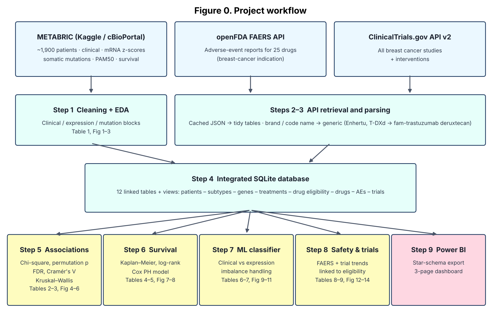

# Integrative Analysis of Breast Cancer Molecular Subtypes, Drug Safety and Clinical Trial Trends using Genomic Data, Machine Learning and Public Health APIs

**Waihida Yashmin** · M.Sc. Biotechnology · SRM Institute of Science and Technology, Kattankulathur
Independent project · 2026



## Abstract
Breast cancer is the most commonly diagnosed cancer in women worldwide and is molecularly heterogeneous. The PAM50 intrinsic subtypes (Luminal A, Luminal B, HER2-enriched, Basal-like, Normal-like) and the claudin-low subtype differ in biology, prognosis and the drugs they respond to. This project integrates three public data sources in one relational database: the METABRIC cohort (~1,900 patients with clinical data, mRNA expression and somatic mutations), FDA Adverse Event Reporting System data for 25 subtype-directed drugs via the openFDA API, and breast cancer studies registered on ClinicalTrials.gov. Clinical and mutational features are compared across subtypes using chi-square tests with permutation p-values, FDR correction and Cramér's V, and with Kruskal–Wallis tests. Disease-specific survival is compared using Kaplan–Meier estimates, log-rank tests and a multivariable Cox model. A classifier with explicit class-imbalance handling tests how much of the molecular subtype routine clinical pathology can recover, compared with gene expression. Each patient is linked to the modern drug classes their tumour profile makes them eligible for, and those classes are compared on safety reporting and trial activity. Results are presented in a three-page Power BI dashboard.

## Aim
To build a reproducible pipeline that links breast cancer molecular subtypes with patient outcomes, real-world drug safety and clinical research activity.

## Objectives
1. Clean and describe the METABRIC cohort (data quality, cohort characteristics by subtype).
2. Identify clinical and genomic features associated with molecular subtype.
3. Compare overall and disease-specific survival across subtypes, adjusting for clinical prognostic factors.
4. Evaluate how well routine clinical and IHC data, compared with gene expression, predict the PAM50 subtype under class imbalance.
5. Analyse adverse-event reporting and clinical-trial trends for 25 drugs across subtype-directed drug classes, linked to patient eligibility.
6. Integrate all sources in a relational database and communicate the findings in a Power BI dashboard.

## Research questions
- **RQ1.** Which clinical features and somatic mutations differ significantly between molecular subtypes, and how strong are these associations?
- **RQ2.** Does molecular subtype predict breast-cancer-specific death independently of age, tumour size, grade and nodal status?
- **RQ3.** How much of the PAM50 subtype can routine pathology (ER, PR, HER2, grade, size, nodes) recover, and which subtypes does it fail to separate?
- **RQ4.** How do serious-report proportions and trial activity differ between drug classes, and has research shifted toward CDK4/6 inhibitors and antibody–drug conjugates?

## Data sources
| Source | Content | Access |
|---|---|---|
| METABRIC, from cBioPortal DataHub (`brca_metabric`) | 1,904 patients with both expression and sequencing data: 31 clinical attributes, mRNA z-scores, non-silent mutations in 173 genes, PAM50 + claudin-low subtype, survival up to ~30 years | Downloaded automatically by Step 0 (no account needed); the Kaggle file *Breast Cancer Gene Expression Profiles (METABRIC)* is the same cohort and can be used instead |
| openFDA `drug/event` (FAERS) | Total, serious and fatal reports, top MedDRA reactions and yearly counts for 25 drugs, restricted to reports with a breast-cancer indication | Free REST API (optional key: `OPENFDA_API_KEY`) |
| ClinicalTrials.gov API v2 | All breast cancer studies: phase, status, start year, enrolment, sponsor, interventions | Free REST API |

**Drugs (25 across 12 classes):** endocrine therapy (tamoxifen, anastrozole, letrozole, exemestane, fulvestrant) · CDK4/6 inhibitors (palbociclib, ribociclib, abemaciclib) · PI3K inhibitor (alpelisib) · HER2 antibodies (trastuzumab, pertuzumab), HER2 TKIs (lapatinib, neratinib, tucatinib) and HER2 ADCs (T-DM1, T-DXd) · immunotherapy (pembrolizumab) · TROP2 ADC (sacituzumab govitecan) · PARP inhibitors (olaparib, talazoparib) · chemotherapy (cyclophosphamide, doxorubicin, paclitaxel, docetaxel, capecitabine).

## Methodology
| Step | Script | Method | Output |
|---|---|---|---|
| 0 | `src/00_get_metabric.py` | Downloads the clinical, sample, expression and mutation files from cBioPortal; keeps patients with both expression and sequencing; writes a Kaggle-format CSV (expression panel: the 173 sequenced genes plus breast cancer marker genes) | `data/raw/METABRIC_RNA_Mutation.csv` |
| 1 | `src/01_data_cleaning.py` | Splits the clinical, expression and mutation blocks; validates labels and ranges; harmonises receptor status; derives HR+, HER2+, TNBC, OS and DSS events | Table 1, Fig 1–3 |
| 2 | `src/02_fetch_openfda.py` | REST queries with caching, rate-limit handling and a breast-cancer indication filter | FAERS tables |
| 3 | `src/03_fetch_clinicaltrials.py` | Paginated retrieval; generic, brand and code-name matching (e.g. Enhertu, T-DXd → fam-trastuzumab deruxtecan) | Trial tables |
| 4 | `src/04_build_database.py` + `sql/` | Normalised SQLite schema (12 tables), patient drug-eligibility rules, analytical views | `breast_cancer.db` |
| 5 | `src/05_subtype_associations.py` | Chi-square tests, 5,000-permutation p-values, Benjamini–Hochberg FDR, bias-corrected Cramér's V; Kruskal–Wallis with ε² | Tables 2–3, Fig 4–6 |
| 6 | `src/06_survival_analysis.py` | Kaplan–Meier (Greenwood CI), multi-group log-rank test, Cox PH (Breslow ties, Newton–Raphson), written in NumPy | Tables 4–5, Fig 7–8 |
| 7 | `src/07_subtype_classifier.py` | Two feature sets (clinical + IHC vs gene expression); stratified hold-out; repeated stratified 5-fold CV; balanced class weights; SMOTE inside the pipeline; imputation and scaling fitted per fold; macro-F1 and balanced accuracy vs a majority baseline; permutation importance | Tables 6–7, Fig 9–11 |
| 8 | `src/08_drug_safety_trials.py` | SQL-driven analysis of FAERS reporting and trial trends | Tables 8–9, Fig 12–14 |
| 9 | `src/09_export_powerbi.py` | Star-schema export | Power BI dashboard |

### Database design
`patients` → `subtypes` · `patients` ⟷ `patient_mutations` / `patient_expression` ⟷ `genes` · `patients` ⟷ `patient_treatments` (therapies given in METABRIC) · `patients` ⟷ `patient_drug_eligibility` ⟷ `drugs` · `drugs` → `adverse_events`, `fda_yearly` · `drugs` ⟷ `trial_interventions` ⟷ `trials`

Eligibility rules are applied to each patient's receptor and mutation status: HR+ → endocrine therapy; HR+/HER2− → CDK4/6 inhibitors; PIK3CA-mutant HR+/HER2− → alpelisib; HER2+ → HER2-targeted drugs; triple-negative → pembrolizumab and sacituzumab govitecan; BRCA-mutant HER2− → PARP inhibitors. These are simplified label indications that ignore disease stage and line of therapy.

## How to run
```bash
pip install -r requirements.txt
python run_pipeline.py                # complete pipeline; Step 0 downloads METABRIC (~300 MB, once)
python run_pipeline.py --skip-fetch   # reuse cached API data
jupyter notebook notebooks/results_walkthrough.ipynb
```
Offline test with synthetic data (on a copy of the folder): `python tests/make_mock_data.py && python run_pipeline.py`. Never report numbers from the synthetic run.

## Repository structure
```
├── run_pipeline.py              runs steps 0–9 in order
├── src/                         00–09 numbered scripts + config.py
├── sql/                         schema.sql, views.sql, analysis_queries.sql
├── notebooks/                   results_walkthrough.ipynb
├── powerbi/                     DASHBOARD_SPEC.md (+ data/ after running)
├── docs/                        workflow figure, report_outline.md
├── outputs/figures | tables     thesis figures (Fig 1–14) and tables (1–9)
└── tests/make_mock_data.py      synthetic fixtures for offline testing
```

## Data licence
METABRIC data from cBioPortal are available under the Open Database License (ODbL 1.0). Cite Curtis et al. 2012 and Pereira et al. 2016 [Ref 5, 6] and cBioPortal [Ref 11] in any public use. If you share an adapted version of the data, share it under the same licence.

## Limitations
- **Treatment era.** METABRIC patients were diagnosed between 1977 and 2005, before adjuvant trastuzumab became standard. HER2-enriched survival therefore reflects largely untreated HER2 disease and overstates its risk today.
- **Population.** The cohort is from the UK and Canada. Indian patients are diagnosed younger on average and have a higher share of triple-negative disease, so the subtype distribution and survival may not transfer.
- **Circularity.** PAM50 is defined by gene expression, so the expression classifier's high score is expected. The informative result is the gap between it and the clinical model.
- **FAERS** is spontaneous reporting with no denominator. The indication filter keeps reports in which any drug was given for breast cancer. Counts are not risk estimates.
- **Eligibility** rules are simplified. They ignore HER2-low status (no IHC scores in METABRIC), stage and line of therapy.
- **Trial–drug matching** uses intervention names and can miss unusual spellings.

## Future work
- External validation on TCGA-BRCA (RNA-seq, PAM50 calls available on cBioPortal).
- HER2-low analysis in a cohort with IHC 0/1+/2+ scores, given T-DXd's approval for HER2-low disease.
- Structure-based follow-up linking this population view to my HER2 molecular-docking work ([github.com/waihida0406](https://github.com/waihida0406)).
- Disproportionality analysis (reporting odds ratios) on FAERS, e.g. interstitial lung disease with T-DXd and cardiotoxicity with trastuzumab.
- Validation in an Indian breast cancer cohort.

## References
1. Sung H, Ferlay J, Siegel RL, et al. Global cancer statistics 2020: GLOBOCAN estimates of incidence and mortality worldwide for 36 cancers in 185 countries. *CA Cancer J Clin*. 2021;71(3):209–249.
2. Perou CM, Sørlie T, Eisen MB, et al. Molecular portraits of human breast tumours. *Nature*. 2000;406(6797):747–752.
3. Parker JS, Mullins M, Cheang MCU, et al. Supervised risk predictor of breast cancer based on intrinsic subtypes. *J Clin Oncol*. 2009;27(8):1160–1167.
4. Prat A, Parker JS, Karginova O, et al. Phenotypic and molecular characterization of the claudin-low intrinsic subtype of breast cancer. *Breast Cancer Res*. 2010;12(5):R68.
5. Curtis C, Shah SP, Chin SF, et al. The genomic and transcriptomic architecture of 2,000 breast tumours reveals novel subgroups. *Nature*. 2012;486(7403):346–352.
6. Pereira B, Chin SF, Rueda OM, et al. The somatic mutation profiles of 2,433 breast cancers refines their genomic and transcriptomic landscapes. *Nat Commun*. 2016;7:11479.
7. Slamon DJ, Clark GM, Wong SG, et al. Human breast cancer: correlation of relapse and survival with amplification of the HER-2/neu oncogene. *Science*. 1987;235(4785):177–182.
8. Cheang MCU, Chia SK, Voduc D, et al. Ki67 index, HER2 status, and prognosis of patients with luminal B breast cancer. *J Natl Cancer Inst*. 2009;101(10):736–750.
9. Galea MH, Blamey RW, Elston CE, Ellis IO. The Nottingham Prognostic Index in primary breast cancer. *Breast Cancer Res Treat*. 1992;22(3):207–219.
10. Modi S, Jacot W, Yamashita T, et al. Trastuzumab deruxtecan in previously treated HER2-low advanced breast cancer. *N Engl J Med*. 2022;387(1):9–20.
11. Cerami E, Gao J, Dogrusoz U, et al. The cBio cancer genomics portal: an open platform for exploring multidimensional cancer genomics data. *Cancer Discov*. 2012;2(5):401–404.
12. Kass-Hout TA, Xu Z, Mohebbi M, et al. OpenFDA: an innovative platform providing access to a wealth of FDA's publicly available data. *J Am Med Inform Assoc*. 2016;23(3):596–600.
13. Kaplan EL, Meier P. Nonparametric estimation from incomplete observations. *J Am Stat Assoc*. 1958;53(282):457–481.
14. Mantel N. Evaluation of survival data and two new rank order statistics arising in its consideration. *Cancer Chemother Rep*. 1966;50(3):163–170.
15. Cox DR. Regression models and life-tables. *J R Stat Soc B*. 1972;34(2):187–220.
16. Benjamini Y, Hochberg Y. Controlling the false discovery rate: a practical and powerful approach to multiple testing. *J R Stat Soc B*. 1995;57(1):289–300.
17. Bergsma W. A bias-correction for Cramér's V and Tschuprow's T. *J Korean Stat Soc*. 2013;42(3):323–328.
18. Chawla NV, Bowyer KW, Hall LO, Kegelmeyer WP. SMOTE: Synthetic Minority Over-sampling Technique. *J Artif Intell Res*. 2002;16:321–357.
19. Pedregosa F, et al. Scikit-learn: Machine learning in Python. *J Mach Learn Res*. 2011;12:2825–2830.
20. cBioPortal DataHub. Breast Cancer (METABRIC, Nature 2012 & Nat Commun 2016), study `brca_metabric`. https://github.com/cBioPortal/datahub *[Add access date.]*
21. U.S. National Library of Medicine. ClinicalTrials.gov API v2. *[Add URL and access date.]*
